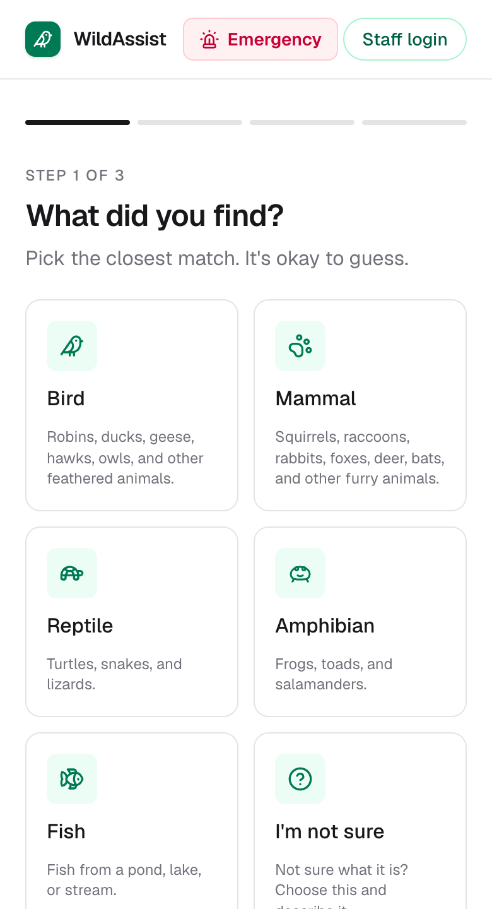

# WildAssist

Found an injured or orphaned wild animal and not sure what to do? WildAssist walks you through it and gets your report to a nearby wildlife rehabilitation centre. It's also the tool those centres and their volunteers use to handle the rescue.

**Live:** https://wildassist.vercel.app

[](https://github.com/mohsin123-04/wildassist/actions/workflows/ci.yml)



## Why

When people find a hurt animal they usually guess, call around, or get it wrong. A lot of "orphaned" babies aren't orphaned, and a cat-caught bird has hours, not days. The centres that could help are mostly running on phone calls and spreadsheets. WildAssist sits in between: the public gets quick, sourced advice and their report lands at the right centre, where staff and volunteers pick it up.

You don't need an account to get help. Everything else is behind roles. The whole thing runs on free tiers.

## What it does

**Public (no login)**
- Guided triage: pick the animal, say what's going on, get a straight answer: leave it, keep an eye on it, or it needs help.
- Optional photo ID that runs a vision model in your browser. Nothing gets uploaded.
- Firm "do not touch" warnings for the dangerous ones (bats, raptors, snakes, raccoons, and so on). These come from a fixed rule list, not the AI.
- Shares your location to route the report to the closest centre that can take it.
- Found a dead animal instead? A separate flow gives you carcass-handling do's and don'ts and flags public-health risks (bird flu, rabies, chronic wasting disease, mass die-offs), then tells you who's responsible for removing it. Like the safety warnings, the flags come from a fixed rule set, with the LLM filling in the specifics.
- After you send a report you get a private tracking link (still no account) that shows its status live as it moves from reported, to on the way, to in care, to resolved.

**Centres and volunteers (login + role)**
- A dashboard of incoming cases scoped to the centre's area, updating live, with search, filters, a map, and CSV export.
- Case detail: the photo, the finder's description, a location link, their contact, staff notes, and a status workflow.
- A volunteer transport feed sorted by distance. Claim a job, deliver it, release it. Volunteers are approved first and can't see the finder's contact until they claim.
- Per-centre messaging: a main channel, direct messages, and group chats, all realtime.
- Analytics for managers and admins: open-queue and response-time metrics over a date range, built from each case's status history (admins can break it down by centre).
- Admins onboard a centre by typing its address (it geocodes itself) and approve volunteers.

## Stack

- Next.js 16 (App Router), React, TypeScript, Tailwind
- Supabase for Postgres, Auth, Storage, and Realtime, with Row-Level Security on every table
- Groq (`gpt-oss-120b`) for triage, grounded in a vetted guidance set; in-browser image classification with `@huggingface/transformers`
- Leaflet + OpenStreetMap, with Nominatim for geocoding
- Vercel for hosting, Vitest for tests, GitHub Actions for CI

## Running it locally

You'll need Node 20+, a Supabase project, and a Groq key. Both are free.

```bash
git clone https://github.com/mohsin123-04/wildassist.git
cd wildassist
npm install
cp .env.local.example .env.local   # fill in the keys below
npm run dev
```

```
GROQ_API_KEY=                 # console.groq.com
NEXT_PUBLIC_SUPABASE_URL=     # Supabase settings > API
NEXT_PUBLIC_SUPABASE_ANON_KEY=
SUPABASE_SERVICE_ROLE_KEY=    # server-side only
```

For the database, run the SQL in `supabase/` from the Supabase SQL editor, starting with `schema.sql` and `seed.sql` and then the migrations. Create two public Storage buckets, `avatars` and `case-photos`.

It starts fine without the Groq key (it falls back to a rule engine) and without the database (the public flow still works), so you can poke at it before wiring everything up.

```bash
npm test     # Vitest
```

The tests cover the logic that actually matters: triage verdicts, danger detection, centre ranking and distance, duplicate detection, email, and the API-route guards (auth, rate limits, the signup privilege check). CI runs them plus a production build on every push.

## Roles

| Role | How they join | What they get |
| --- | --- | --- |
| Public | No account | Triage and guidance |
| Volunteer | Sign up, then get approved | Area-scoped transport jobs |
| Staff | Sign up with a centre join code | Their centre's cases |
| Manager | Set when the centre is onboarded | Staff view, plus join code, team, and volunteer approvals |
| Health officer | Sign up as a wildlife health officer | A surveillance board of deceased-animal reports across the US and Canada, with the disease flags |
| Admin | Set by the operator | Every case, centre onboarding, oversight |

Demo accounts (shared, so please be gentle), password `wildlife2026`:

| Email | Role |
| --- | --- |
| `staff@wildassist.ca` | Staff |
| `demo@wildassist.ca` | Manager |
| `admin@wildassist.ca` | Admin |
| `volunteer@wildassist.ca` | Volunteer |

## Security

- Row-Level Security on every table, including distance rules (staff only see cases near their centre) and membership rules (you only see conversations you're in).
- The service-role key stays on the server and is never shipped to the browser.
- Public endpoints are rate-limited per IP by an atomic Postgres function, so nobody can drain the AI quota or flood storage.

## A note

I built this to learn and to see whether the idea holds up. The guidance and centre contact details were checked in 2026 against sources like Toronto Wildlife Centre, Ontario SPCA, Audubon, and Tufts Wildlife Clinic, but seasonal details change. If you've actually found an animal in distress, call a licensed wildlife rehabilitator directly.

MIT licensed.
